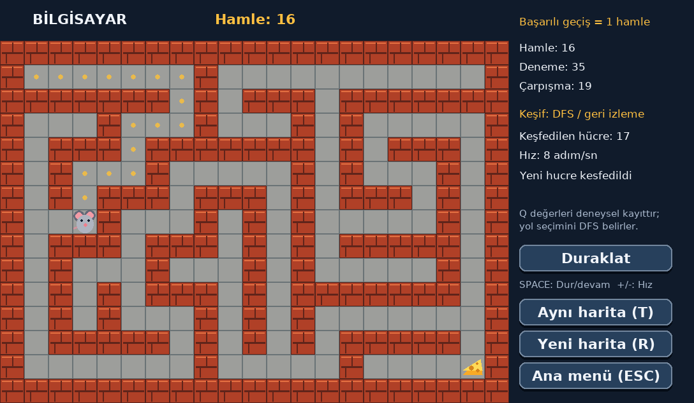

# Labirent | Fare ve Peynir

Python ve Pygame ile üç modlu labirent oyunu: kullanıcı peyniri bulur, bilgisayar keşfederek peyniri bulur veya iki kullanıcı aynı yerel ağda yarışır.



## Ders isterleri

| İster | Uygulama |
|---|---|
| Bilgisayar peyniri bulsun | DFS keşfi, duvar hafızası ve geri izleme |
| Kullanıcı peyniri bulsun | WASD / yön tuşları |
| İki fare ağ üzerinden oynasın | TCP 50505; oda kur / odaya katıl |
| Her modda hamle tutulsun | Başarılı hücre geçişi = 1 hamle; deneme ve çarpışma ayrı |
| En az 3 test senaryosu | 3 ana kabul senaryosu + 15 otomatik test |
| Dokümantasyon hazırlansın | Aşağıdaki Markdown belgeleri ve PDF |

## Kurulum (Windows PowerShell)

Python 3.10 veya üzeri önerilir. Doğrulama ortamı: Python 3.12.14 ve Pygame 2.6.1.

```powershell
python -m venv .venv
.\.venv\Scripts\python.exe -m pip install -r requirements.txt
.\.venv\Scripts\python.exe src\main.py
```

Linux/macOS:

```bash
python3 -m venv .venv
.venv/bin/python -m pip install -r requirements.txt
.venv/bin/python src/main.py
```

## Kontroller

- **Manuel:** WASD / yön tuşları. R: yeni harita, T: aynı haritayı tekrar oyna.
- **Bilgisayar:** Space: dur/devam, +/-: hız, R: yeni harita, T: aynı haritada yeniden keşif.
- **Çok oyunculu:** WASD / yön tuşları. Kazanan belli olduktan sonra oda sahibi R ile yeni yarış başlatır.
- **Her ekranda:** ESC: ana menü. Pencereyi kapatmak bağlantıları da kapatır.
- **Ayarlar:** Bilgisayar hızı ve keşif izi; oturum boyunca korunur.

Hamle yalnızca başarılı hücre geçişidir. Duvara çarpınca hamle artmaz; deneme ve çarpışma artar. `deneme = hamle + çarpışma`. Bilgisayarın geri dönüşleri de hamledir. Kazananın belirlenmesinden sonra yarış hareketleri durur. Yarışı az hamle yapan değil, peynire ilk ulaşan kazanır; hamleler karşılaştırma için tutulur.

## Aynı ağda iki kişi

1. İki bilgisayarda oyunu kurun ve aynı Wi-Fi/LAN'a bağlanın.
2. Birinci bilgisayar: **Çok oyunculu > Oda kur**.
3. Oda sahibi PowerShell'de `ipconfig` çalıştırıp kullandığı Wi-Fi/Ethernet bağlantısının IPv4 adresini bulsun.
4. İkinci bilgisayar: **Çok oyunculu** ekranındaki adresi silip bu IPv4 adresini yazsın, **Odaya katıl** desin.
5. Harita aktarımı ve hazır onayından sonra yarış başlar. Gri fare P1, mavi fare P2'dir.
6. Güvenlik duvarı izin isterse Python'a yalnızca **özel ağ** izni verin. Misafir Wi-Fi cihazlar arası erişimi engelleyebilir. İnternete port yönlendirme gerekmez.

`127.0.0.1`, iki pencerenin aynı bilgisayarda denenmesi içindir; başka bilgisayara bağlanmak için oda sahibinin LAN IPv4 adresini kullanın. Bağlantı koparsa ESC ile menüye dönüp yeni oda kurun; yarım yarış kaldığı yerden sürdürülmez.

## Bilgisayar nasıl buluyor?

Ajan, seçtiği hareketin sonucuna bakarak duvarları ve geçitleri kaydeder. Denenmemiş komşulara ilerler; çıkmazda yol yığını üzerinden geri döner. Yeni harita, birbirine bağlı geçitlerden oluştuğu için hedef bulunabilir. Oyuncu haritayı ve peyniri görür; ajan hedefe uzaklık hesabı yapmaz.

**Bu sürümde yol seçimini DFS belirler.** `rl_agent.py` içinde korunan Q-Learning güncellemeleri deneysel kayıttır; öğrenilmiş bir politikanın başarı artışı iddia edilmez. Aynı haritada tekrar oynamak Q tablosunu da sıfırlar. Ders görselinde RL zorunlu değildir; bilgisayarın peyniri bulması istenmektedir.

## Test

```powershell
.\.venv\Scripts\python.exe -m unittest discover -s tests -v
```

Linux/macOS: `.venv/bin/python -m unittest discover -s tests -v`

Testler pencere açmadan SDL dummy sürücüsüyle ve yerel TCP soketleriyle çalışır. Ayrı fiziksel bilgisayarlar arasındaki güvenlik duvarı/Wi-Fi davranışı bu testlerin kapsamında değildir.

## Dokümantasyon

- [Tek PDF: proje, kullanım ve test raporu](docs/Labirent_Dokumantasyon.pdf)
- [Algoritma ve mimari](docs/algoritma.md)
- [Kullanım kılavuzu](docs/kullanim_kilavuzu.md)
- [Test raporu ve üç kabul senaryosu](docs/test_raporu.md)

PDF mail eki olarak hazırdır. Mail gönderimi yapılmamıştır; alıcı adresi ve gönderim talimatı ayrıca gereklidir.

## Dosyalar

| Dosya | Görevi |
|---|---|
| `src/main.py` | Uygulama, menüler, olay döngüsü |
| `src/rendering.py` | Pygame çizimi |
| `src/maze.py` | Bağlı, döngüsüz rastgele labirent |
| `src/player.py` | Hareket, hamle ve çarpışma kuralları |
| `src/rl_agent.py` | DFS keşfi ve deneysel Q değerleri |
| `src/network.py` | Arka planda TCP okuma/yazma, sınırlı kuyruklar |
| `src/multiplayer.py` | Harita/başlama protokolü ve sunucu otoriteli yarış |
| `tests/test_game.py` | Oyun, ağ ve ekran kontrolleri |

## Sınırlar

Yerel ağda iki oyuncu içindir; hesap sistemi, internet eşleştirmesi veya otomatik bağlantı kurtarma yoktur. Sabit ekran 1088 × 634 pikseldir. İki fiziksel cihazla son kabul testi teslimden önce yapılmalıdır. Ağ mesajlarında biçim ve boyut denetimi bulunur, ancak bu bir internete açık oyun sunucusu değildir.
