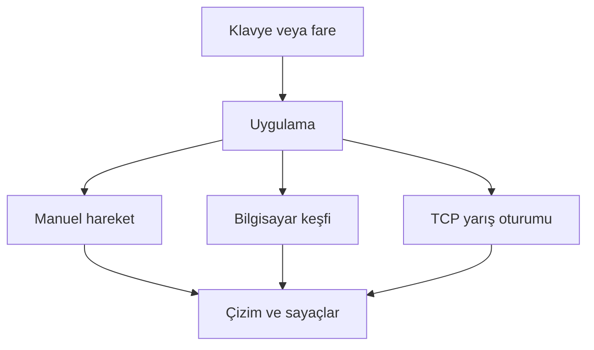

# Algoritma ve mimari

## Veri akışı

## Labirent üretimi

`generate_maze` 15 satır ve 21 sütun üretir. Başlangıç (1,1), hedef (19,13) olur. Duvarlardan oluşan ızgarada iki hücre aralıklı ziyaret edilmemiş komşu seçilir, aradaki duvar açılır ve yol yığınına eklenir. Komşu kalmayınca geri dönülür. Böylece bütün geçitler bağlı, döngüsüz bir labirent elde edilir. Testlerde `seed` ile aynı labirent tekrar oluşturulabilir. Boyutlar 3-51 arası tam sayı olmalı; çift boyut bir artırılır.

## Bilgisayar keşfi

`visited` ziyaret edilen hücreleri, `known_map` öğrenilen duvar/geçitleri, `tried_actions` denenen yönleri, `path_stack` geri dönüş yolunu tutar. Sol, yukarı, sağ, aşağı yönleri değerlendirilir. Ajan yalnızca seçtiği hareketin sonucunu öğrenir; haritayı topluca taramaz ve hedefe uzaklık hesabı yapmaz. Mevcut fonksiyon imzası ortam ızgarasını alır, fakat yalnızca hareket hedefindeki hücreyi sorgular. Peynire erişince durur; başlangıç hedefse sıfır hamlede biter.

Keşfedilmemiş komşu kalmayınca bir önceki hücreye geri dönülür. Bilgisayarın en kısa yolu ilk denemede bulması beklenmez. DFS yığınına dayalı keşif, bağlantılı labirentlerde hedefe erişir.

Q güncellemesi `Q(s,a) += alpha * (r + gamma * max Q(s',a') - Q(s,a))` biçimindedir. Terminal durumda gelecekteki değer sıfırdır. Alpha=0.3, gamma=0.9; yeni hücre ödülü 4.9, hedef ek ödülü 100, duvar cezası -5'tir. DFS geri dönüşü -0.1 olarak istatistiğe eklenir, Q güncellemesi yapılmaz. Denenmiş eylemlerin yeniden seçilmemesi nedeniyle bu sürümde Q değerleri etkili bir öğrenilmiş politika oluşturmaz; arayüz bunu açıkça belirtir.

## Hamle tanımı

Başarılı, bitişik bir hücreye geçiş 1 hamledir. Duvar girişimi yalnızca deneme ve çarpışmayı artırır. DFS geri dönüşleri hamleye dahildir. Bütün modlarda `deneme = hamle + çarpışma` eşitliği korunur. Kazanıldıktan sonra sayaç değişmez. Yeni oyun/tur sayaçları sıfırlar.

## İki oyunculu protokol

TCP 50505 üzerinden satır sonuyla ayrılmış JSON nesneleri taşınır. Oda sahibi tek otoritedir: iki oyuncunun hareketlerini doğrular, sayaçları ve kazananı hesaplar. İstemci konum bildirmek yerine yön isteği gönderir.

1. Bağlantı kurulunca oda sahibi `init` (harita, başlangıç, hedef, tur) yollar.
2. İstemci haritayı doğrular ve `ready` yollar.
3. Oda sahibi `state` ile yarışı başlatır; istemci bu durum gelmeden hareket göndermez.
4. İstemcinin `move` isteği işlendiğinde iki oyuncunun `state` bilgisi gönderilir.
5. Kazanma sonrası oda sahibi yeni tur başlatabilir. Eski tur kimliğine ait mesajlar yok sayılır.

Okuma/yazma arka plan iş parçacıklarında yapılır. Gelen/giden kuyruklar sınırlıdır; aşırı büyük veya geçersiz mesajda bağlantı kapatılır. Saniyede 60 karelik ana döngü bloklayan ağ gönderimi yapmaz. ESC ve pencere kapatma soketleri kapatır. Bağlantı kopunca hareket durur, kullanıcı menüden yeni bağlantı kurar.
